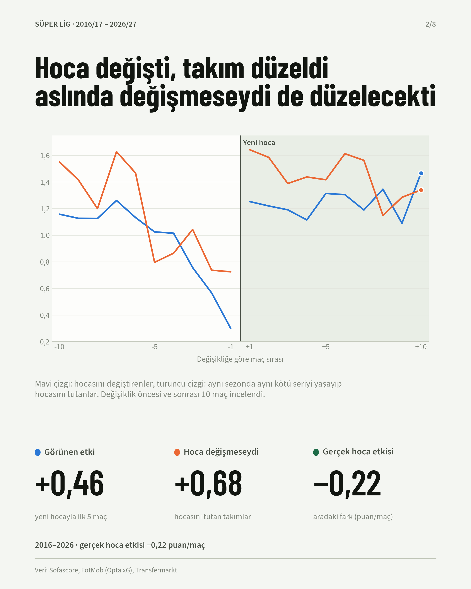

# Süper Lig'de hoca kovmak gerçekten etkili mi?

Sezon ortasında teknik direktör değiştiren takımlar yeni hocayla gerçekten mi düzeliyor, yoksa zaten
gelecek olan bir toparlanmayı mı yaşıyor? Bu çalışma 2016/17 – 2026/27 arasındaki **223 sezon içi hoca
değişikliğini** ve **3.418 Süper Lig maçını** gerçek puan, xG ve bahis oranlarıyla inceliyor.

**İnteraktif dashboard:** [`dashboard/index.html`](dashboard/index.html) dosyasını indirip tarayıcıda
açabilirsin.



## Ana bulgular

| | Maç başına puan |
|---|---|
| **Görünen etki:** yeni hocayla ilk 5 maçta puanın artışı | **+0,46** |
| **Hoca değişmeseydi:** aynı kötü seriyi yaşayıp hocasını tutan takımların aynı dönemdeki toparlanması | **+0,68** |
| **Gerçek hoca etkisi:** görünen etki − hoca değişmeseydi | **−0,22** (%95 GA: −0,31 … −0,12) |

- **Toparlanma zaten gelecekti.** Hocalar en dipte gönderiliyor (kovulmadan önceki son maçta ortalama 0,30 puan). Bu dipten sonra takım hoca kim olursa olsun toparlanıyor; buna ortalamaya dönüş deniyor. 10 maçlık pencerede gerçek hoca etkisi sıfırdan ayırt edilemiyor.
- **Çöküş çoğunlukla şanssızlık.** Kovulmadan önceki 5 maçta takımlar maç başına 0,81 puan alırken xG'ye göre 1,17 hak ediyordu (xG verisi olan 2022/23+ sezonları).
- **Yönetimler skora bakıyor, oyuna değil.** Son 5 maçta maç başına 0,5 puan daha az almak, hocanın o hafta gönderilme ihtimalini ×1,89 artırıyor; son maçı kaybetmek ×4,74. Puan aynıyken xG'ye göre oyunun kalitesinin hiçbir ek etkisi yok (×1,03, anlamsız). Kovulan hocaların %83'ü son 5 maçta xG'nin hak ettirdiğinden az puan almıştı.
- **Türkiye'de hocaya zaman yok.** Kulüp başına sezon içi hoca değişikliği 5 büyük ligin yaklaşık 2,6 katı. Kulüplerin %70'i her sezon en az bir kez hoca değiştiriyor (5 büyük lig: %32–39).
- **Kovulan hoca çoğunlukla Türkiye'de kalıyor.** Sezon ortasında gönderilen hocaların %61'i sonra yine Süper Lig'de iş buluyor, %56'sı başka bir kulüpte.

Tüm sayılar [`results/`](results/) klasöründeki özet tablolarda.

## Yöntem

Yöntem, *"The sacking illusion: A counterfactual analysis of mid-season coaching changes using points
and expected points in European football"* (Journal of Sports Sciences, 2026) çalışmasından Süper Lig'e
uyarlandı.

| Adım | Açıklama |
|---|---|
| Olay | Sezon içinde kalıcı teknik direktörün ayrılması (geçici hocaların ayrılışı sayılmaz). |
| Pencere | Değişiklikten önce ve sonra 5 ve 10 lig maçı, tamamı aynı sezon içinde. |
| Hoca değişmeseydi | Aynı sezonda, ±5 maç haftası içinde, son 5 maçta **birebir aynı puanı** toplamış ve pencere boyunca hoca değiştirmemiş takımlar. Aralarından maç haftası ve takım gücü (bahis oranına göre beklenen puan) en yakın 5 takım seçilir. |
| Gerçek hoca etkisi | Görünen etki − hoca değişmeseydi. Teknik adı: fark içinde fark (difference-in-differences). |
| xG'ye göre beklenen puan | İki takımın xG'si bağımsız Poisson ortalaması kabul edilir; xP = 3·P(galibiyet) + P(beraberlik). |
| Bahis oranına göre beklenen puan | Maç öncesi 1X2 oranlarından marjı temizlenmiş olasılıklar. |
| Belirsizlik | Değişiklikler üzerinden 2000 tekrarlı bootstrap, %95 güven aralığı. |
| Kovulma riski | Takım-maç panelinde lojistik regresyon: "hoca bu maçtan sonra gönderildi mi?" |

**Sınırlar:** "Hoca değişmeseydi" grubundaki takımlar ortalamada biraz daha güçlü; güç farkı en sıkı
şekilde eşitlendiğinde gerçek hoca etkisi sıfıra yaklaşıyor. Yani güvenli sonuç "hoca değiştirmek
ortalamada fayda sağlamıyor" cümlesidir. xG verisi yalnızca 2022/23 sezonundan itibaren var.

## Klasör yapısı

```
├── dashboard/index.html     # interaktif sonuç sayfası
├── figures/                 # LinkedIn carousel'i (PNG + PDF)
├── results/                 # özet tablolar
│   ├── ozet_hoca_etkisi.csv          # görünen etki, hoca değişmeseydi, gerçek hoca etkisi
│   ├── event_study.csv               # değişiklikten −10 … +10 maç ortalamaları
│   ├── team_summary.csv              # takım bazında ortalamalar
│   ├── sans_gruplari.csv             # önceki şanssızlığa göre üç grup
│   ├── kovulma_riski_modeli.csv      # lojistik regresyon risk çarpanları
│   ├── league_comparison.csv         # Süper Lig vs 5 büyük lig
│   ├── en_cok_gorev_alan_hocalar.csv
│   └── hoca_karuseli_ozet.json
└── scripts/                 # analiz kodu
    ├── 02_build_dataset.py      # ham veri → takım-maç tablosu, hoca değişiklikleri
    ├── 03_analyze.py            # görünen etki, hoca değişmeseydi, gerçek hoca etkisi
    ├── 04_build_dashboard.py    # sonuçlar → dashboard
    ├── 05_league_comparison.py  # Süper Lig vs 5 büyük lig
    ├── 06_linkedin_visuals.py   # carousel görselleri
    ├── 07_extensions.py         # kovulma riski, şans grupları, hoca karuseli
    └── dashboard_template.html
```

## Veri hakkında

Analizde Sofascore (maç sonuçları, bahis oranları), FotMob (Opta xG), Transfermarkt (teknik direktör
değişiklikleri) ve Wikipedia (ayrılış şekli) verileri kullanıldı.

**Ham veri bu depoda yer almıyor.** xG değerleri ve bahis oranları ilgili şirketlerin ticari, lisanslı
ürünleri; bu sitelerin kullanım koşulları verinin toplu olarak yeniden dağıtılmasına izin vermiyor.
Bu yüzden depoda yalnızca kod ve toplulaştırılmış sonuçlar var. Kod okunabilir ve denetlenebilir;
baştan çalıştırmak için aynı yapıda kendi verini `data/raw/` klasörüne koyman gerekir:

| Dosya | İçerik (alanlar) |
|---|---|
| `sofascore_matches.json` | Maç listesi: `season, id, ts, round, home, homeId, away, awayId, hg, ag, xgH, xgA, oH, oD, oA, oH0, oD0, oA0` |
| `fotmob_xg.json` | Maç başına xG: `season, utc, home, away, score, xgH, xgA` |
| `tm_coach_changes.json` | Hoca değişiklikleri: `season, sec, club, out, outRole, rankOut, end, tenure, inn, inRole` |
| `wiki_managerial_changes.json` | Ayrılış şekli: `season, Team, Outgoing manager, Manner of departure, Date of vacancy` |
| `tm_big5_coach_changes.json` | 5 büyük lig + Süper Lig hoca değişiklikleri (`league` alanıyla) |

```bash
pip install -r requirements.txt
python scripts/02_build_dataset.py
python scripts/03_analyze.py
python scripts/05_league_comparison.py
python scripts/07_extensions.py
python scripts/04_build_dashboard.py
python scripts/06_linkedin_visuals.py
```

## Notlar

- Analiz ve kod bir yapay zekâ asistanı (Claude) ile birlikte geliştirildi. Araştırma sorusu, kapsam
  ve sunum kararları bana ait.
- Sonuçlar akademik hakem sürecinden geçmemiş, keşif amaçlı bir analizdir.
